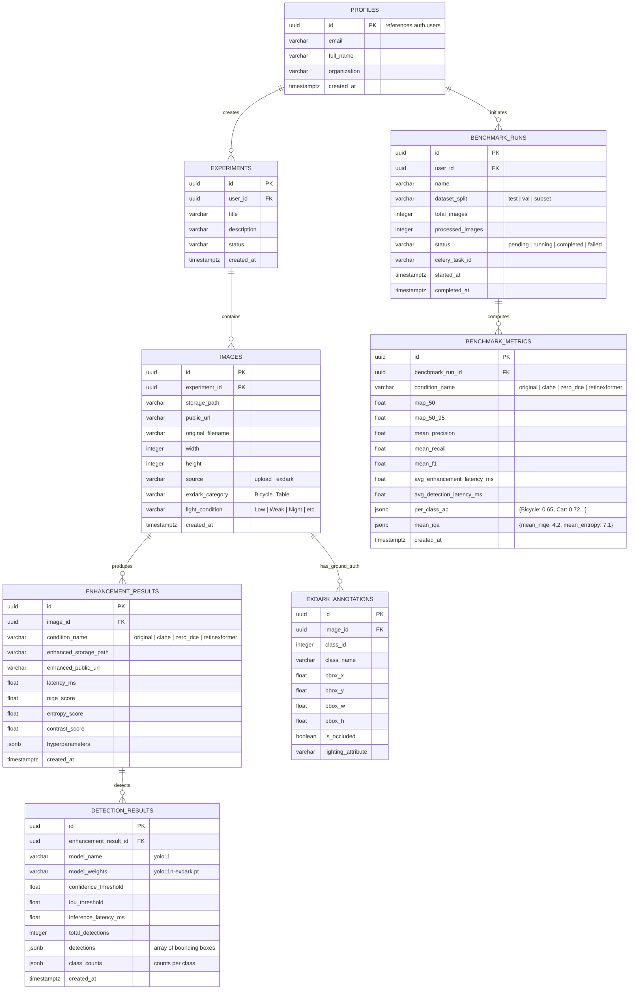

# LUXVISION AI — Database Schema Specification

## 1. Overview & Architecture

The **LUXVISION AI** database layer is designed for **PostgreSQL** hosted on **Supabase**. It provides:
1. **User Identity Integration**: Tight coupling with Supabase's managed `auth.users` schema.
2. **Experiment & Provenance Tracking**: Full lineage tracing an input image through all four enhancement conditions to their corresponding YOLO11 detections and quality metrics.
3. **High-Performance JSONB Storage**: Flexible storage for variable-length bounding boxes, class detection frequencies, and per-class Average Precision (AP) scores.
4. **Row Level Security (RLS)**: Enforces multi-tenant data privacy while allowing public read access to standardized ExDark benchmark records.
5. **Supabase Object Storage**: Management of storage buckets for raw inputs, enhanced variations, and generated research exports.

---

## 2. Entity-Relationship Diagram



---

## 3. SQL Data Definition Language (DDL)

The following SQL script sets up the complete schema with constraints, triggers, and indices.

```sql
-- Enable necessary extensions
CREATE EXTENSION IF NOT EXISTS "uuid-ossp";
CREATE EXTENSION IF NOT EXISTS "pgcrypto";

-- ============================================================================
-- 1. PROFILES TABLE (Linked with Supabase auth.users)
-- ============================================================================
CREATE TABLE public.profiles (
    id UUID PRIMARY KEY REFERENCES auth.users(id) ON DELETE CASCADE,
    email VARCHAR(255) NOT NULL,
    full_name VARCHAR(100),
    organization VARCHAR(150),
    role VARCHAR(50) DEFAULT 'researcher',
    created_at TIMESTAMP WITH TIME ZONE DEFAULT TIMEZONE('utc', NOW()) NOT NULL,
    updated_at TIMESTAMP WITH TIME ZONE DEFAULT TIMEZONE('utc', NOW()) NOT NULL
);

-- ============================================================================
-- 2. EXPERIMENTS TABLE
-- ============================================================================
CREATE TABLE public.experiments (
    id UUID PRIMARY KEY DEFAULT uuid_generate_v4(),
    user_id UUID REFERENCES public.profiles(id) ON DELETE CASCADE,
    title VARCHAR(200) NOT NULL,
    description TEXT,
    experiment_type VARCHAR(50) DEFAULT 'four_way_comparison',
    status VARCHAR(50) DEFAULT 'created',
    created_at TIMESTAMP WITH TIME ZONE DEFAULT TIMEZONE('utc', NOW()) NOT NULL,
    updated_at TIMESTAMP WITH TIME ZONE DEFAULT TIMEZONE('utc', NOW()) NOT NULL
);

-- ============================================================================
-- 3. IMAGES TABLE
-- ============================================================================
CREATE TABLE public.images (
    id UUID PRIMARY KEY DEFAULT uuid_generate_v4(),
    experiment_id UUID REFERENCES public.experiments(id) ON DELETE CASCADE,
    storage_path TEXT NOT NULL,
    public_url TEXT NOT NULL,
    original_filename VARCHAR(255) NOT NULL,
    file_size_bytes BIGINT,
    mime_type VARCHAR(50) DEFAULT 'image/jpeg',
    width INTEGER,
    height INTEGER,
    source VARCHAR(50) DEFAULT 'user_upload' CHECK (source IN ('user_upload', 'exdark_dataset', 'benchmark_sample')),
    exdark_category VARCHAR(50),
    light_condition VARCHAR(100),
    created_at TIMESTAMP WITH TIME ZONE DEFAULT TIMEZONE('utc', NOW()) NOT NULL
);

-- ============================================================================
-- 4. ENHANCEMENT_RESULTS TABLE
-- ============================================================================
CREATE TABLE public.enhancement_results (
    id UUID PRIMARY KEY DEFAULT uuid_generate_v4(),
    image_id UUID NOT NULL REFERENCES public.images(id) ON DELETE CASCADE,
    condition_name VARCHAR(50) NOT NULL CHECK (condition_name IN ('original', 'clahe', 'zero_dce', 'retinexformer')),
    enhanced_storage_path TEXT,
    enhanced_public_url TEXT,
    latency_ms DOUBLE PRECISION NOT NULL,
    niqe_score DOUBLE PRECISION,
    entropy_score DOUBLE PRECISION,
    contrast_score DOUBLE PRECISION,
    psnr_score DOUBLE PRECISION,
    ssim_score DOUBLE PRECISION,
    hyperparameters JSONB DEFAULT '{}'::jsonb,
    created_at TIMESTAMP WITH TIME ZONE DEFAULT TIMEZONE('utc', NOW()) NOT NULL,
    CONSTRAINT unique_image_condition UNIQUE (image_id, condition_name)
);

-- ============================================================================
-- 5. DETECTION_RESULTS TABLE
-- ============================================================================
CREATE TABLE public.detection_results (
    id UUID PRIMARY KEY DEFAULT uuid_generate_v4(),
    enhancement_result_id UUID NOT NULL REFERENCES public.enhancement_results(id) ON DELETE CASCADE,
    model_name VARCHAR(50) DEFAULT 'yolo11' NOT NULL,
    model_weights VARCHAR(100) DEFAULT 'yolo11n-exdark.pt' NOT NULL,
    confidence_threshold DOUBLE PRECISION DEFAULT 0.25 NOT NULL,
    iou_threshold DOUBLE PRECISION DEFAULT 0.45 NOT NULL,
    inference_latency_ms DOUBLE PRECISION NOT NULL,
    total_detections INTEGER DEFAULT 0 NOT NULL,
    detections JSONB DEFAULT '[]'::jsonb NOT NULL,
    class_counts JSONB DEFAULT '{}'::jsonb NOT NULL,
    created_at TIMESTAMP WITH TIME ZONE DEFAULT TIMEZONE('utc', NOW()) NOT NULL,
    CONSTRAINT unique_enhancement_detection UNIQUE (enhancement_result_id)
);

-- ============================================================================
-- 6. BENCHMARK_RUNS TABLE
-- ============================================================================
CREATE TABLE public.benchmark_runs (
    id UUID PRIMARY KEY DEFAULT uuid_generate_v4(),
    user_id UUID REFERENCES public.profiles(id) ON DELETE SET NULL,
    name VARCHAR(200) NOT NULL,
    dataset_name VARCHAR(50) DEFAULT 'ExDark' NOT NULL,
    dataset_split VARCHAR(50) DEFAULT 'test' NOT NULL,
    total_images INTEGER NOT NULL,
    processed_images INTEGER DEFAULT 0 NOT NULL,
    status VARCHAR(50) DEFAULT 'pending' CHECK (status IN ('pending', 'running', 'completed', 'failed', 'cancelled')),
    celery_task_id VARCHAR(100),
    error_message TEXT,
    started_at TIMESTAMP WITH TIME ZONE,
    completed_at TIMESTAMP WITH TIME ZONE,
    created_at TIMESTAMP WITH TIME ZONE DEFAULT TIMEZONE('utc', NOW()) NOT NULL
);

-- ============================================================================
-- 7. BENCHMARK_METRICS TABLE
-- ============================================================================
CREATE TABLE public.benchmark_metrics (
    id UUID PRIMARY KEY DEFAULT uuid_generate_v4(),
    benchmark_run_id UUID NOT NULL REFERENCES public.benchmark_runs(id) ON DELETE CASCADE,
    condition_name VARCHAR(50) NOT NULL CHECK (condition_name IN ('original', 'clahe', 'zero_dce', 'retinexformer')),
    map_50 DOUBLE PRECISION NOT NULL,
    map_50_95 DOUBLE PRECISION NOT NULL,
    mean_precision DOUBLE PRECISION NOT NULL,
    mean_recall DOUBLE PRECISION NOT NULL,
    mean_f1 DOUBLE PRECISION NOT NULL,
    avg_enhancement_latency_ms DOUBLE PRECISION NOT NULL,
    avg_detection_latency_ms DOUBLE PRECISION NOT NULL,
    per_class_ap JSONB DEFAULT '{}'::jsonb NOT NULL,
    mean_iqa JSONB DEFAULT '{}'::jsonb NOT NULL,
    created_at TIMESTAMP WITH TIME ZONE DEFAULT TIMEZONE('utc', NOW()) NOT NULL,
    CONSTRAINT unique_benchmark_condition UNIQUE (benchmark_run_id, condition_name)
);

-- ============================================================================
-- 8. EXDARK_ANNOTATIONS TABLE
-- ============================================================================
CREATE TABLE public.exdark_annotations (
    id UUID PRIMARY KEY DEFAULT uuid_generate_v4(),
    image_id UUID NOT NULL REFERENCES public.images(id) ON DELETE CASCADE,
    class_id INTEGER NOT NULL CHECK (class_id BETWEEN 0 AND 11),
    class_name VARCHAR(50) NOT NULL,
    bbox_x DOUBLE PRECISION NOT NULL,  -- normalized [0, 1]
    bbox_y DOUBLE PRECISION NOT NULL,  -- normalized [0, 1]
    bbox_w DOUBLE PRECISION NOT NULL,  -- normalized [0, 1]
    bbox_h DOUBLE PRECISION NOT NULL,  -- normalized [0, 1]
    is_occluded BOOLEAN DEFAULT FALSE,
    lighting_attribute VARCHAR(50)
);
```

---

## 4. JSON Schema Specifications

### 4.1 `detections` Column in `detection_results`
Stores the normalized array of detected bounding boxes conforming to the 12 ExDark classes:
```json
[
  {
    "box_id": 1,
    "class_id": 10,
    "class_name": "People",
    "confidence": 0.8742,
    "bbox": {
      "x1": 142.5,
      "y1": 89.0,
      "x2": 268.0,
      "y2": 450.2,
      "normalized": [0.2226, 0.1854, 0.4187, 0.9379]
    }
  },
  {
    "box_id": 2,
    "class_id": 4,
    "class_name": "Car",
    "confidence": 0.6519,
    "bbox": {
      "x1": 310.0,
      "y1": 210.4,
      "x2": 612.0,
      "y2": 415.8,
      "normalized": [0.4843, 0.4383, 0.9562, 0.8662]
    }
  }
]
```

### 4.2 `per_class_ap` Column in `benchmark_metrics`
Stores class-specific Average Precision ($AP_{50}$) for detailed radar and bar visualizations:
```json
{
  "Bicycle": 0.584,
  "Boat": 0.412,
  "Bottle": 0.395,
  "Bus": 0.728,
  "Car": 0.691,
  "Cat": 0.512,
  "Chair": 0.443,
  "Cup": 0.368,
  "Dog": 0.554,
  "Motorbike": 0.612,
  "People": 0.741,
  "Table": 0.489
}
```

---

## 5. Performance Indices

```sql
-- Fast lookup of results per experiment
CREATE INDEX idx_images_experiment_id ON public.images(experiment_id);
CREATE INDEX idx_enhancement_image_id ON public.enhancement_results(image_id);
CREATE INDEX idx_detection_enhancement_id ON public.detection_results(enhancement_result_id);

-- Fast lookup for benchmark evaluations
CREATE INDEX idx_benchmark_metrics_run_id ON public.benchmark_metrics(benchmark_run_id);
CREATE INDEX idx_benchmark_runs_user_id ON public.benchmark_runs(user_id);
CREATE INDEX idx_benchmark_runs_status ON public.benchmark_runs(status);

-- Filtering ExDark dataset images by class & lighting
CREATE INDEX idx_images_source_category ON public.images(source, exdark_category);
CREATE INDEX idx_annotations_image_class ON public.exdark_annotations(image_id, class_id);
```

---

## 6. Row Level Security (RLS) Policies

```sql
-- Enable RLS across all tables
ALTER TABLE public.profiles ENABLE ROW LEVEL SECURITY;
ALTER TABLE public.experiments ENABLE ROW LEVEL SECURITY;
ALTER TABLE public.images ENABLE ROW LEVEL SECURITY;
ALTER TABLE public.enhancement_results ENABLE ROW LEVEL SECURITY;
ALTER TABLE public.detection_results ENABLE ROW LEVEL SECURITY;
ALTER TABLE public.benchmark_runs ENABLE ROW LEVEL SECURITY;
ALTER TABLE public.benchmark_metrics ENABLE ROW LEVEL SECURITY;
ALTER TABLE public.exdark_annotations ENABLE ROW LEVEL SECURITY;

-- 1. Profiles: Users can read and update their own profile
CREATE POLICY "Users view own profile" ON public.profiles FOR SELECT USING (auth.uid() = id);
CREATE POLICY "Users update own profile" ON public.profiles FOR UPDATE USING (auth.uid() = id);

-- 2. Experiments: Users manage their own experiments
CREATE POLICY "Users manage own experiments" ON public.experiments FOR ALL USING (auth.uid() = user_id);

-- 3. Public read for ExDark curated dataset records
CREATE POLICY "Allow public read of ExDark reference images" ON public.images FOR SELECT USING (source = 'exdark_dataset');
CREATE POLICY "Allow public read of ExDark annotations" ON public.exdark_annotations FOR SELECT USING (TRUE);

-- 4. Benchmark Runs: Users view own benchmark runs
CREATE POLICY "Users manage own benchmarks" ON public.benchmark_runs FOR ALL USING (auth.uid() = user_id);
CREATE POLICY "Users view benchmark metrics" ON public.benchmark_metrics FOR SELECT USING (
    EXISTS (SELECT 1 FROM public.benchmark_runs WHERE benchmark_runs.id = benchmark_metrics.benchmark_run_id AND benchmark_runs.user_id = auth.uid())
);
```

---

## 7. Supabase Storage Buckets Configuration

LUXVISION AI utilizes three distinct storage buckets configured in Supabase:

| Bucket Name | Access Level | Allowed MIME Types | Max Size | Purpose |
| :--- | :--- | :--- | :--- | :--- |
| `raw-images` | Authenticated + Public Read | `image/jpeg`, `image/png`, `image/webp` | 20 MB | Original low-light images uploaded by researchers or imported from ExDark |
| `enhanced-images` | Authenticated + Public Read | `image/png`, `image/jpeg` | 20 MB | Processed outputs for CLAHE, Zero-DCE, and Retinexformer |
| `benchmark-exports` | Authenticated (Private) | `text/csv`, `application/json`, `application/pdf` | 50 MB | Exported research summaries, CSV tables, and LaTeX figures |

