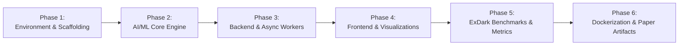

# LUXVISION AI — Development Roadmap & Implementation Plan

This roadmap provides a phased, step-by-step engineering plan designed for academic rigor, maintainability, and scientific reproducibility.

---

## 1. Phase Overview

---

## 2. Phase-by-Phase Roadmap

### Phase 1: Environment Setup, Scaffolding & Infrastructure
**Goal**: Establish isolated runtime environments for both Python and Node.js, verify GPU/CUDA acceleration, configure Redis, and initialize the Supabase database.

- [ ] **Step 1.1**: Initialize Python virtual environment (`.venv`) and configure `requirements.txt`:
  - Core ML: `torch`, `torchvision`, `ultralytics` (YOLO11), `opencv-python`, `scikit-image`, `scipy`.
  - Backend: `fastapi`, `uvicorn[standard]`, `pydantic`, `pydantic-settings`, `python-multipart`.
  - Database & Cloud: `sqlalchemy`, `asyncpg`, `supabase`, `redis`, `celery`.
- [ ] **Step 1.2**: Scaffold the Frontend with Vite, React, TypeScript, and Tailwind CSS:
  - Install dependencies: `@supabase/supabase-js`, `recharts`, `lucide-react`, `clsx`, `tailwind-merge`, `axios`.
  - Configure Tailwind dark-mode research theme and font typography.
- [ ] **Step 1.3**: Configure Supabase PostgreSQL:
  - Execute DDL from `DATABASE_SCHEMA.md` in Supabase SQL editor.
  - Create Storage buckets: `raw-images`, `enhanced-images`, `benchmark-exports`.
- [ ] **Step 1.4**: Configure Redis for local caching and Celery message broker.
- **Verification Gate**:
  - `python -c "import torch; print('CUDA Available:', torch.cuda.is_available())"` returns expected hardware acceleration.
  - Supabase connectivity test successfully executes a query.
  - Redis ping returns `PONG`.

---

### Phase 2: AI / ML Enhancement & Detection Pipeline (The Research Core)
**Goal**: Implement the four image conditions and standard YOLO11 detector with strictly controlled evaluation parameters.

- [ ] **Step 2.1**: Implement `BaseEnhancer` abstract interface in `backend/app/ml/enhancement/base.py`:
  - Standard input: RGB numpy array ($H \times W \times C$, range $[0, 255]$).
  - Standard output: RGB numpy array, execution latency (ms), and configuration metadata.
- [ ] **Step 2.2**: Implement Condition 2: `CLAHEEnhancer`:
  - Convert RGB to CIELAB space.
  - Apply OpenCV CLAHE to the L* (luminance) channel (`clipLimit=3.0`, `tileGridSize=(8,8)`).
  - Recombine channels and convert back to RGB.
- [ ] **Step 2.3**: Implement Condition 3: `ZeroDCEEnhancer`:
  - Implement Zero-DCE deep curve estimation network architecture (`DCE_Net`).
  - Create checkpoint loader for pre-trained weights (`Zero-DCE.pth`).
  - Implement iterative curve application ($LE_n$) in PyTorch with FP16 support.
- [ ] **Step 2.4**: Implement Condition 4: `RetinexformerEnhancer`:
  - Implement Retinexformer architecture (Illumination Estimator + IG-MSA Transformer blocks).
  - Create checkpoint loader for low-light enhancement weights (`Retinexformer_ExDark.pth`).
  - Implement memory-efficient tiled inference for high-resolution images to prevent CUDA Out-of-Memory (OOM).
- [ ] **Step 2.5**: Implement `YOLO11Detector` in `backend/app/ml/detection/yolo11.py`:
  - Ultralytics YOLO11 wrapper configured with the identical model checkpoint (`yolo11n-exdark.pt` or `yolo11s-exdark.pt`).
  - Enforce strictly invariant hyperparameters across all calls: $\text{conf}=0.25$, $\text{iou}=0.45$, $\text{imgsz}=640$.
  - Output normalized bounding boxes, labels mapped to the 12 ExDark categories, and confidence scores.
- [ ] **Step 2.6**: Implement IQA & Detection Metrics Module (`backend/app/ml/evaluation/`):
  - Shannon Information Entropy calculator.
  - Natural Image Quality Evaluator (NIQE) blind assessment.
  - Contrast & dynamic range metrics.
  - Real-time IoU matching and Mean Average Precision (mAP@50) calculation against ground truth.
- **Verification Gate**:
  - Run an offline validation script (`backend/tests/ml_tests/test_pipeline_offline.py`) that feeds a sample low-light image through all four conditions and YOLO11.
  - Verify that the exact same YOLO11 model weights are invoked for all four conditions and produce valid bounding boxes.

---

### Phase 3: Backend REST API & Asynchronous Worker
**Goal**: Build the FastAPI service orchestrating the multi-stage pipeline, managing Supabase Storage, and handling asynchronous batch evaluation tasks via Celery.

- [ ] **Step 3.1**: Setup FastAPI application structure, CORS middleware, and lifespan model loading:
  - Pre-load PyTorch models into GPU memory on startup to avoid cold-start latencies.
- [ ] **Step 3.2**: Implement Single-Image Comparison Endpoint:
  - `POST /api/v1/inference/compare` accepts multipart image upload.
  - Runs Condition 1 (Original), Condition 2 (CLAHE), Condition 3 (Zero-DCE), and Condition 4 (Retinexformer).
  - Executes YOLO11 on each enhanced frame.
  - Uploads original and enhanced images to Supabase Storage.
  - Stores experiment and detection records in PostgreSQL.
  - Returns complete JSON payload.
- [ ] **Step 3.3**: Configure Celery worker and Redis broker (`backend/app/workers/tasks.py`):
  - Define `evaluate_exdark_batch_task` for background evaluation of ExDark test images.
  - Store progress percentage and intermediate stats in Redis for real-time frontend polling.
- [ ] **Step 3.4**: Implement ExDark Dataset Explorer Endpoints:
  - `GET /api/v1/exdark/categories` and `GET /api/v1/exdark/samples`.
  - Return curated low-light reference images with ground truth annotations.
- [ ] **Step 3.5**: Implement Academic Export Endpoints:
  - `GET /api/v1/export/csv/{benchmark_id}`: Exports research metrics to CSV.
  - `GET /api/v1/export/latex/{benchmark_id}`: Generates IEEE/CVPR formatted LaTeX table code.
- **Verification Gate**:
  - Execute API integration tests with `pytest`.
  - Verify `/api/v1/inference/compare` returns status 200 with all 4 conditions populated.
  - Trigger a Celery task and verify task state transitions from `PENDING` $\rightarrow$ `PROGRESS` $\rightarrow$ `SUCCESS`.

---

### Phase 4: Frontend Development & Synchronized Visualizations
**Goal**: Develop a responsive, modern research interface with synchronized multi-canvas inspection, detection overlays, and interactive Recharts analytics.

- [ ] **Step 4.1**: Setup Frontend foundation:
  - React Router navigation: Dashboard, Live Inference / Comparison, Benchmark Runner, ExDark Explorer, Research Notes.
  - Supabase Auth integration (login/register, user profile badge).
- [ ] **Step 4.2**: Implement Synchronized 4-Way Comparison Canvas:
  - Render a quad-view layout (Original, CLAHE, Zero-DCE, Retinexformer).
  - Synchronize mouse drag (pan) and wheel (zoom) across all four viewports using CSS transform matrix synchronization.
  - Include split-screen slider mode for direct A/B comparison.
- [ ] **Step 4.3**: Implement Interactive Detection Overlay Layer:
  - Render SVG/Canvas bounding boxes over each condition with class-specific color palettes (from `classes.json`).
  - Confidence slider allowing real-time client-side filtering without re-running backend models.
  - Class filter checklist to isolate specific categories (e.g. show only "People" and "Bicycle").
- [ ] **Step 4.4**: Implement Research Analytics Components using Recharts:
  - Grouped Bar Chart: Comparing detection count and confidence across the 4 methods.
  - Multi-Metric Radar Chart: Visualizing trade-offs between Latency, Contrast, Entropy, and Detection Accuracy.
  - Latency breakdown waterfall chart (Enhancement time vs. YOLO11 detection time).
- [ ] **Step 4.5**: Implement ExDark Explorer Page:
  - Visual gallery of the 12 ExDark classes with filter pills for lighting conditions (Night, Twilight, Indoor).
  - "Test This Image" button to immediately run the sample through the 4-way comparison canvas.
- **Verification Gate**:
  - Test browser UI responsiveness across screen resolutions.
  - Verify that panning/zooming on any canvas viewport synchronously updates all four viewports with zero lag.
  - Verify bounding boxes align accurately over image coordinates.

---

### Phase 5: ExDark Dataset Benchmarking & Scientific Validation
**Goal**: Conduct rigorous batch evaluations on the ExDark dataset, compute exact mAP@50 and mAP@50-95 metrics, and ensure zero synthetic data fabrication.

- [ ] **Step 5.1**: ExDark Dataset Ingestion Script (`data/scripts/download_exdark.py`):
  - Download official ExDark image subsets and annotations.
  - Parse bounding box annotations and convert to standardized format.
- [ ] **Step 5.2**: Batch Evaluation Execution:
  - Execute benchmark runs across representative ExDark test subsets.
  - Compute True Positives (TP), False Positives (FP), and Precision-Recall curves at IoU thresholds 0.50 to 0.95.
  - Calculate mAP per condition.
- [ ] **Step 5.3**: Benchmark Runner UI:
  - Web UI to trigger a benchmark run with selectable sample size.
  - Live progress bar with ETA and current image preview.
  - Final results table displaying mAP@50, mAP@50-95, Precision, Recall, Latency, and NIQE.
  - One-click "Copy LaTeX Table" button for the research paper.
- **Verification Gate**:
  - Verify that mAP calculation matches standard COCO / Pascal VOC evaluation protocol.
  - Confirm that all four conditions use the identical evaluation loop and ground-truth matches.

---

### Phase 6: Containerization, Testing & Academic Presentation
**Goal**: Package the entire system into a deployment-ready multi-container Docker stack and finalize thesis presentation materials.

- [ ] **Step 6.1**: Dockerize the application:
  - `Dockerfile.backend`: FastAPI + PyTorch + CUDA/CPU + OpenCV.
  - `Dockerfile.celery`: Celery worker with PyTorch runtime.
  - `Dockerfile.frontend`: Multi-stage build with Node.js and Nginx Alpine.
  - `docker-compose.yml`: Orchestrates frontend, backend, worker, and Redis containers.
- [ ] **Step 6.2**: Comprehensive automated test suite:
  - Unit tests for enhancement modules, metric computations, and API schemas.
  - End-to-end integration tests for the full comparative pipeline.
- [ ] **Step 6.3**: Thesis & Presentation Documentation:
  - Generate sample comparative figures and benchmark charts.
  - Document system deployment instructions and API documentation.

