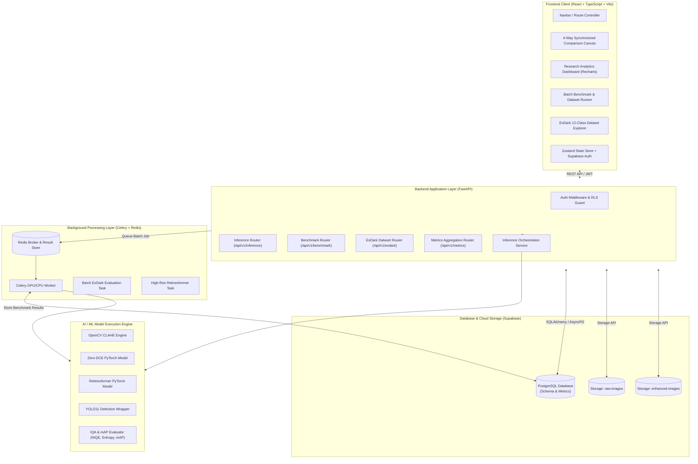
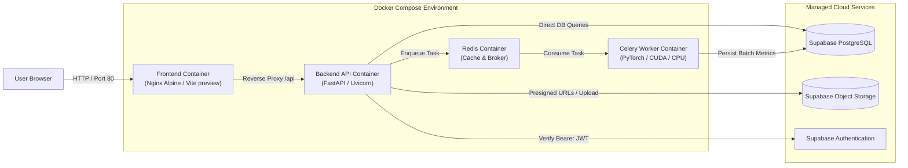

# LUXVISION AI — System Architecture Specification

## 1. Executive Summary & Research Foundation

**LUXVISION AI** is an advanced, research-grade comparative analysis platform designed to benchmark and visualize the impact of modern low-light image enhancement techniques on downstream computer vision tasks—specifically **Object Detection** using **YOLO11** on the **ExDark (Exclusively Dark)** benchmark dataset.

The platform embodies the methodology of the research paper:
> *"Comparative Analysis of Low-Light Image Enhancement Techniques for Improved Object Detection"*

### Research Problem
Standard object detection models suffer catastrophic degradation in low-light environments due to low photon counts, high sensor noise, reduced dynamic range, and non-uniform illumination. Enhancing images prior to detection has become a primary paradigm, but different enhancement philosophies present distinct trade-offs between visual quality, computational overhead, artifact introduction, and actual feature discernibility for deep neural networks.

### The Four Experimental Conditions
LUXVISION AI rigorously compares four parallel conditions on identical input images:

| Condition | Paradigm | Method | Characteristics |
| :--- | :--- | :--- | :--- |
| **Condition 1** | Baseline | **Original Low-Light** | Unmodified raw input image directly passed to YOLO11. Establishes the performance floor. |
| **Condition 2** | Classical Physics/Heuristic | **CLAHE** (Contrast Limited Adaptive Histogram Equalization) | Local histogram equalization applied on the luminance (L*) channel in CIELAB color space with contrast limiting to prevent noise over-amplification. Fast, zero-parameter learning. |
| **Condition 3** | Deep Learning (Unsupervised) | **Zero-DCE** (Deep Curve Estimation) | Lightweight Deep CNN that formulates enhancement as image-specific curve estimation without paired ground-truth images. Extremely low parameter count (~79K) and near real-time execution. |
| **Condition 4** | Deep Learning (SOTA Transformer) | **Retinexformer** | Retinex-based transformer framework utilizing illumination-guided self-attention (IG-MSA) to capture non-local degradation features and restore fine spatial textures under severe darkness. |

```
                                 ┌──────────────────────────────┐
                                 │   Raw Low-Light Input Image  │
                                 └──────────────┬───────────────┘
                                                │
                 ┌──────────────────────────────┼──────────────────────────────┬──────────────────────────────┐
                 ▼                              ▼                              ▼                              ▼
        ┌──────────────────┐           ┌──────────────────┐           ┌──────────────────┐           ┌──────────────────┐
        │   Condition 1    │           │   Condition 2    │           │   Condition 3    │           │   Condition 4    │
        │     Original     │           │      CLAHE       │           │     Zero-DCE     │           │  Retinexformer   │
        │    (Baseline)    │           │   (Classical)    │           │  (Curve Estim.)  │           │  (Transformer)   │
        └────────┬─────────┘           └────────┬─────────┘           └────────┬─────────┘           └────────┬─────────┘
                 │                              │                              │                              │
                 ▼                              ▼                              ▼                              ▼
        ┌──────────────────┐           ┌──────────────────┐           ┌──────────────────┐           ┌──────────────────┐
        │  Enhanced Frame  │           │  Enhanced Frame  │           │  Enhanced Frame  │           │  Enhanced Frame  │
        │   (Identical)    │           │   (Lab Equal.)   │           │   (Non-Ref DL)   │           │  (Transf. SOTA)  │
        └────────┬─────────┘           └────────┬─────────┘           └────────┬─────────┘           └────────┬─────────┘
                 │                              │                              │                              │
                 └──────────────────────────────┼──────────────────────────────┴──────────────────────────────┘
                                                │
                                                ▼  [STRICTLY IDENTICAL WEIGHTS & HYPERPARAMETERS]
                                 ┌──────────────────────────────┐
                                 │   YOLO11 Detection Engine    │
                                 │  (Confidence=0.25, IoU=0.45) │
                                 └──────────────┬───────────────┘
                                                │
                 ┌──────────────────────────────┴──────────────────────────────┐
                 ▼                                                             ▼
   ┌──────────────────────────────┐                              ┌──────────────────────────────┐
   │   Visual Object Detection    │                              │  Scientific Metrics Engine   │
   │  - 12 ExDark Class Boxes     │                              │  - NIQE, Shannon Entropy     │
   │  - Detection Confidence      │                              │  - mAP@50, Precision, Recall │
   │  - Class Frequency Counts    │                              │  - Enhancement & Detect Time │
   └──────────────────────────────┘                              └──────────────────────────────┘
```

---

## 2. Scientific Fairness Principles

To ensure rigorous scientific validity, LUXVISION AI strictly adheres to the following experimental controls:

1. **Weight Invariance**: The identical YOLO11 model checkpoint (e.g., `yolo11n-exdark.pt` or `yolo11s-exdark.pt`) is deployed across all four conditions.
2. **Hyperparameter Uniformity**: Inference resolution ($640 \times 640$), confidence score threshold ($\tau_{conf} = 0.25$), Non-Maximum Suppression (NMS) IoU threshold ($\tau_{iou} = 0.45$), and maximum detections per image ($N_{max} = 300$) remain strictly constant.
3. **No Synthetic Metric Fabrication**: All reported detection metrics (mAP, Precision, Recall, Box Counts) and image quality scores (NIQE, BRISQUE, Shannon Entropy) are computed in real time by the PyTorch and NumPy evaluation engines.
4. **Isolated Enhancement Timing**: Processing latency is broken down into separate components:
   $$\text{Total Latency} = t_{\text{enhancement}} + t_{\text{yolo11\_inference}} + t_{\text{postprocess}}$$

---

## 3. High-Level System Architecture

LUXVISION AI is engineered with a modern, decoupled full-stack architecture optimized for high-throughput AI inference and responsive interactive visualization.



---

## 4. Subsystem Specifications

### 4.1 Frontend Client Subsystem
- **Framework**: React 18+ with Vite for ultra-fast HMR and optimized tree-shaking.
- **Language**: TypeScript (strict type checking across all ML schemas).
- **Styling**: Tailwind CSS with dark-mode research UI aesthetics (slate/zinc palette, neon accents for 12 ExDark classes).
- **Key Modules**:
  1. **Quad-View Synchronized Canvas**: Synchronized viewport where panning or zooming into any of the 4 conditions updates the other 3 synchronously via transform matrix coordinates.
  2. **Interactive Detection Overlay**: Canvas layer overlaying bounding boxes, class labels, and confidence tags. Allows filtering by confidence threshold, toggling specific classes, and inspecting box coordinates.
  3. **Visual Analytics (Recharts)**:
     - Grouped Bar Charts comparing mAP@50 and detected counts across the 4 methods.
     - Radar Charts plotting multidimensional trade-offs: Latency vs. Contrast vs. Entropy vs. Detection Accuracy.
     - Class-by-Class AP breakdown across the 12 ExDark categories.
  4. **Dataset Explorer**: Category-based browser for ExDark samples (Bicycle, Boat, Bottle, Bus, Car, Cat, Chair, Cup, Dog, Motorbike, People, Table) with ground truth vs. predicted inspection.

### 4.2 Backend API Gateway (FastAPI)
- **Framework**: FastAPI (Python 3.10+) utilizing asynchronous route handlers (`async/await`).
- **Data Validation**: Pydantic v2 schemas guaranteeing strict type serialization between Python and TypeScript.
- **ORM / Database Engine**: SQLAlchemy 2.0 with async engine connecting to Supabase PostgreSQL.
- **Authentication**: JWT token verification integrating directly with Supabase Auth identities.
- **File Handling**: Streaming multipart uploads with memory bounds and automated image dimension normalization.

### 4.3 AI / Machine Learning Engine
- **Runtime**: PyTorch 2.x with automatic device selection (`cuda` if available with FP16 acceleration, fallback to `cpu`).
- **Enhancement Architecture**:
  - `BaseEnhancer`: Common abstract interface (`enhance(image_rgb: np.ndarray) -> EnhancementResult`).
  - `CLAHEEnhancer`: Converts RGB $\rightarrow$ LAB, applies OpenCV CLAHE with configurable `clipLimit=3.0` and `tileGridSize=(8,8)` on L-channel, converts back to RGB.
  - `ZeroDCEEnhancer`: PyTorch CNN estimating 8 sets of curve parameter maps $\mathcal{A}$, iteratively brightening the image using $LE_n(x) = LE_{n-1}(x) + \mathcal{A}_n(x) LE_{n-1}(x)(1 - LE_{n-1}(x))$.
  - `RetinexformerEnhancer`: State-of-the-art transformer estimating illumination prior and using Illumination-Guided Multi-Head Self-Attention (IG-MSA) for deep degradation restoration.
- **Detection Architecture**:
  - `YOLO11Detector`: Ultralytics YOLO11 wrapper with custom weight loading, uniform confidence filtering, and label formatting for ExDark's 12 classes.
- **Image Quality Assessment (IQA)**:
  - Shannon Information Entropy: $H = -\sum_{i=0}^{255} p_i \log_2 p_i$ measuring dynamic visual detail.
  - NIQE (Natural Image Quality Evaluator): Blind perceptual quality index.
  - Mean Local Contrast & Michelson contrast.

### 4.4 Background Worker & Queue Subsystem
- **Message Broker**: Redis.
- **Task Queue**: Celery.
- **Purpose**: Decouples long-running batch evaluation jobs (running all 4 enhancement algorithms and YOLO11 across hundreds of ExDark test images) from the web request-response cycle.
- **Job Status Tracking**: Provides real-time polling or WebSocket endpoints reporting completed image counts, estimated time remaining, and intermediate mAP calculations.

---

## 5. ExDark (Exclusively Dark) Dataset Specification

The ExDark dataset is the core benchmark used in this platform, featuring images captured exclusively in low-light environments (indoor darkness, twilight, night, shadows).

### 12 Target Classes & Taxonomy
```
1. Bicycle      5. Car         9. Dog
2. Boat         6. Cat        10. Motorbike
3. Bottle       7. Chair      11. People
4. Bus          8. Cup        12. Table
```

### Low-Light Environmental Conditions in ExDark
ExDark categorizes images across 10 distinct low-light contexts:
- Low-light indoors
- Weak artificial lighting
- Nighttime streetlights
- Moonlight / Twilight
- Strong backlighting / Shadows

LUXVISION AI incorporates these tags to allow fine-grained performance slicing (e.g., *"How does Retinexformer perform specifically under nighttime streetlights vs. deep indoor darkness?"*).

---

## 6. Deployment Architecture



---

## 7. System Scalability & Extensibility

1. **Modular Enhancer Plugin Architecture**: Additional enhancement models (e.g., KinD, EnlightenGAN, SCI, Restormer) can be added by implementing the `BaseEnhancer` abstract class.
2. **Detector Swapping**: The detector interface is abstracted so other detection backbones (e.g., RT-DETR, Faster R-CNN) can be plugged in for cross-architecture validation.
3. **Reproducibility & Research Export**: Complete evaluation runs can be exported as structured CSV files, JSON payloads, or auto-formatted LaTeX tables directly embeddable into academic papers.

